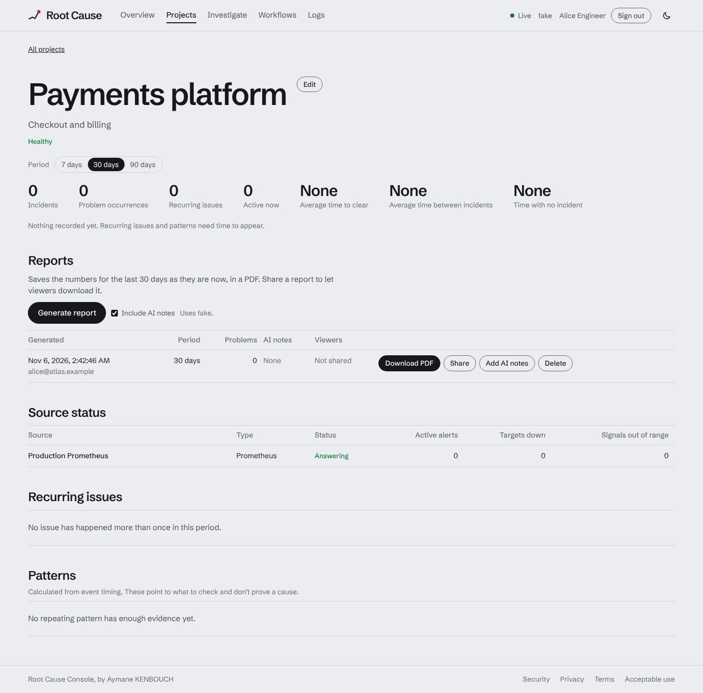

# Root Cause Console

Created by Aymane KENBOUCH.

Connect your metrics, keep a live picture of your systems, and ask an AI model why something broke.
Each installation serves one company, with its own server and database. Each answer is checked against your data. Remediation workflows are instructions for people, and alerts are read-only, so this software never changes your systems.



## Install it

It runs inside your own infrastructure, so it can reach your systems directly. You need a server with Docker:

```bash
sh deploy/setup-env.sh
docker compose up -d --build
```

The script asks a few questions, then writes `.env` with new secrets and prints your first password. Open the address, sign in with your email, and choose a new password. Then go to **Connections** and add a metric source.

See [docs/DEPLOY.md](docs/DEPLOY.md) for certificates, Kubernetes, and servers with no internet access.

## What's included

| Area | What you get |
|---|---|
| Golden signals | Latency, traffic, errors, and saturation at a glance, including Spring, NGINX ingress, JVM, container, database, and queue metrics when they exist |
| Metric sources | Prometheus, including Amazon, Azure, and Google managed sign-in, Amazon CloudWatch, and Azure Monitor |
| More evidence | Loki logs, read-only Kubernetes state, deployment events by webhook, and Alertmanager alerts |
| AI models | Ollama on your own server, or Claude with an API key |
| Answer checks | Cited numbers are compared with your data, cited queries are run, a competing explanation is required, and "unknown" is accepted |
| Cost | Tokens, cost, and time per investigation, a monthly budget, and a token limit per investigation |
| Workflows | Built-in remediation guides shown as a pipeline, followed and checked off one step at a time, with AI drafts that need review. Nothing runs them |
| Alerts | Read-only messages through Slack, email, including Gmail, Google Chat, and Teams |
| Teams | Accounts by email invitation with email sign-in, four roles, private investigations you can choose to share, single sign-on (OIDC), security policies, and an exportable audit log |
| Projects | Groups of sources with live status, incidents, recurring issues, false-alarm verdicts, patterns, and PDF reports with AI notes |
| Database | SQLite for one machine, or PostgreSQL |

## Roles

| Role | Can do |
|---|---|
| Viewer | See status, saved charts, shared reports, and the question and answer of shared investigations |
| Engineer | Also investigate, run queries, edit panels and projects, generate reports, record verdicts, and follow and write workflows |
| Admin | Also manage connections, AI settings, alerts, and members, read all investigations and the audit log, and review workflows |
| Owner | Also manage security policies and single sign-on |

[docs/ARCHITECTURE.md](docs/ARCHITECTURE.md) has the full table, the product's rules, and diagrams.

## Projects and reports

A project groups the sources behind one system. Its page shows their status, how often each problem came back, how long it lasted, and timing patterns, such as problems that start together or soon after a deployment.

**Generate report** saves those numbers and creates a PDF, with optional AI notes marked as AI opinion. Reports stay with engineers until someone shares them. All the numbers are calculated from recorded events, not by the AI model. So recurring issues and patterns need time to appear after you connect a source.

## Develop

To run the app without Docker, on plain HTTP, you need Python 3.11 or newer. On first start, sign in as `admin@rootcause.local` with the password `admin`. You'll be asked for your own email, name, and password. This default exists only for development, because production mode refuses to start without your own.

```bash
python3 -m venv .venv && source .venv/bin/activate
pip install -r requirements-dev.txt
RCC_ALLOW_LOOPBACK_TARGETS=true python -m app
ruff check .
pytest
RCC_TEST_DATABASE_URL=postgresql://user@localhost/rcc_test pytest   # also tests PostgreSQL
```

The app uses FastAPI on the server and plain JavaScript modules in the browser, with no build step.

## Current limits

- **One server:** live runs, rate limits, and monitoring live in one process, so run a single instance. Use a larger server rather than several copies.
- **Evidence:** it has no distributed traces, and it can only find causes that its connected sources can show.
- **Sign-in:** there's no built-in two-factor sign-in. Use single sign-on and your provider's two-factor settings.
- **Checks:** answer checks catch made-up numbers and failed queries. They can't prove that a diagnosis is right.
- **Accuracy:** no accuracy scores come with this software. Check a model against your own past incidents before trusting it.
- **Older data:** a version 1 database is copied to a backup file and replaced on first start, so older logs stay in that file.

See also [SECURITY.md](SECURITY.md), [docs/PENTEST-RESPONSE.md](docs/PENTEST-RESPONSE.md), and [docs/COMPLIANCE.md](docs/COMPLIANCE.md).
