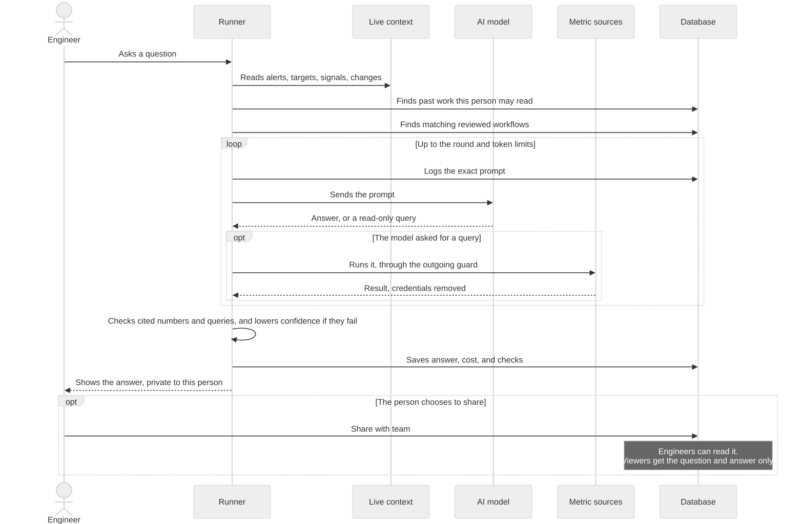
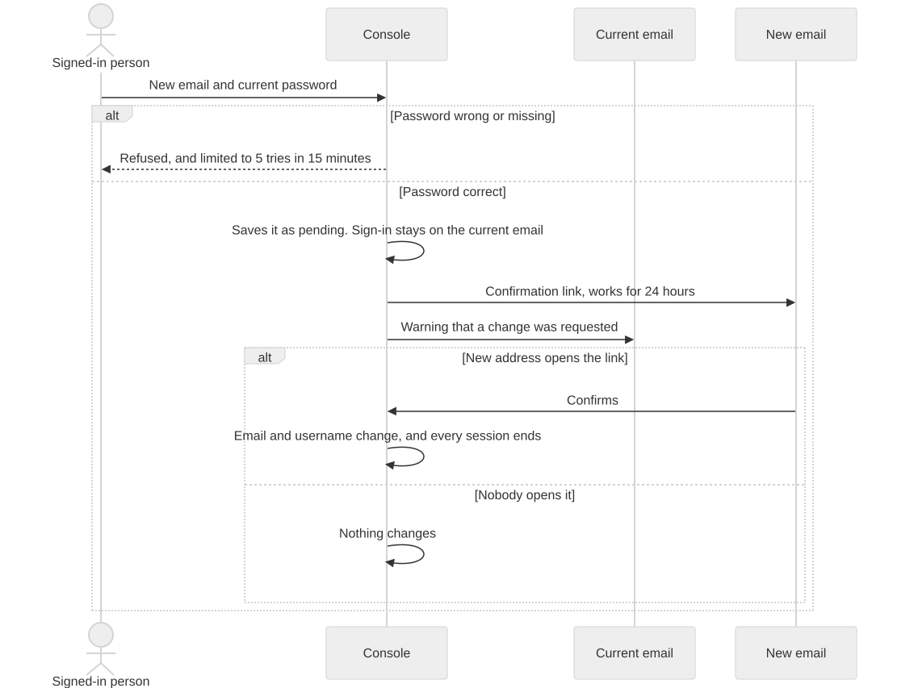

# How it works

Diagram sources are in `docs/diagrams` as Mermaid files, next to the rendered SVG files.

## Architecture

Each installation serves one company, with its own server and database. People reach it through Caddy over HTTPS. Requests pass the security layer, then the role checks. The app only reads from your systems, and every outgoing connection goes through one guard. Claude, Gemini, and message channels are reached only if you set them up.

## Connections, problems, and what the model receives

Every connection is optional. A metric source, a log store, or a Kubernetes cluster is each enough to build a live context and run an investigation. Tools are offered to the model only for what is connected: metric queries with a metric source, `query_logs` with a log store, and `get_kubernetes_state`, `describe_object`, and `get_pod_logs` with a cluster.

Each poll gathers problems from every connection into one list, worst first: firing alerts, down targets, Kubernetes problems, failing rules, and unusual signals. Kubernetes problems are keyed on the workload that owns the pods, so one crash-looping Deployment is one problem however many pods it restarts. Problems start and clear as events, which drive the overview, alert channels, automatic investigations, and reports.

For the worst Kubernetes problems, the engine reads the crashed container's last 30 lines, once per restart, and `app/diagnosis/rules.py` recognises known failures in code: an error on start, OOMKilled, liveness probe kills, missing Secrets or ConfigMap keys, image pull failures, unschedulable pods, stuck rollouts, and node trouble. The model receives PROBLEMS RIGHT NOW first, with each diagnosis and the log lines inside `<untrusted_logs>`. Events and emails keep the diagnosis, not the log lines.

After an answer, the check in `app/investigation/verification.py` compares cited numbers and queries with the data, flags evidence that is really a failed query's error, and flags an answer that never names an active problem. Models of about 8B or fewer get a shorter prompt and the 4 most useful tools.

## Who sees what

The server enforces this on every request. Hiding something on a page is never the only protection.

| Page | Viewer | Engineer | Admin | Owner |
|---|---|---|---|---|
| Overview | Status, golden signals, saved charts, and which Kubernetes workloads are failing. No queries, labels, addresses, logs, or diagnosis evidence | Full, with queries and targets | Full | Full |
| Projects | Status, incidents, issues, and reports someone shared | Also create reports and record verdicts | Also delete projects | Same as admin |
| Investigate | **Results only:** the question and the answer, for shared and automatic investigations. No input box | Own private work, plus shared and automatic work | All investigations | All investigations |
| Workflows (runbook library) | Read reviewed runbooks: steps, commands, project, and servers. Can't follow or write them | Follow reviewed runbooks, and write drafts | Also review and archive | Same as admin |
| Logs | Hidden | Own and shared investigations and prompts, and state changes | All, plus alerts sent and the audit trail | Same as admin |
| Connections, AI settings | Hidden | Hidden. Can choose a model, without seeing its address | Full | Full |
| Organization | Hidden | Hidden | Usage and members | Also security policies and single sign-on |
| Docs (/docs) | Yes | Yes | Yes | Yes |
| Your account | Yes | Yes | Yes | Yes |

**Why admins can read every investigation:** someone has to be able to oversee what's sent to an AI model, and the audit trail needs a person who can check it. If your organization wants this narrower, give fewer people the admin role.

## Rules the product follows

**Investigations are private until shared.** Whoever starts one owns it. Other engineers can't open it, and its contents don't reach another person's AI model as "related past work." Choosing **Share with team** lets engineers read it and viewers see its questions and answers. Automatic investigations of critical alerts are always visible to the team, because no single person owns them. Sharing publishes an answer as it was written, and an answer can name hosts, so read it first.

**One outage counts as one incident.** Problems that start within 10 minutes of each other, or during an incident's first hour, form one incident. From incidents the console calculates the average time to clear, the average time between incidents, and the share of time with no incident. These are calculated from recorded events, not by the AI model.

**People decide what's a false alarm.** An issue that keeps clearing within minutes gets a suggestion that it may be a false alarm. Only an engineer's verdict changes anything: *false alarm* and *expected* stop that issue counting towards project health and the real totals, and reports state how many occurrences were set aside.

**A critical alert's email waits for its investigation.** So one email carries the alert, findings, evidence charts, reviewed commands, and a PDF. It never waits longer than 10 minutes, and a failed investigation or a restart can't lose the alert, because the waiting email is saved in the database. Chat channels don't wait. Charts come from the queries the AI ran. A model that can't run queries still gets charts of the signals behind the alert.

**A report is a fixed record.** It saves the numbers as they were. It stays with engineers and above until someone shares it. Its AI notes receive calculated sentences to repeat as they are, and numbers that don't appear in the data are flagged in the PDF.

**A workflow is followed, not run.** This software has no way to run a command. Only a reviewed workflow can be followed, one step at a time and in order. Everyone on the team sees the same progress and who did each step, so a shift can hand over. A step that changes something asks the person to accept its risk, and skipping a step needs a reason. A run keeps a copy of the steps, so editing the workflow doesn't change a run in progress. Any edit returns the workflow to draft for another review. Results are kept, so the team can see whether a workflow actually helps.

**The email is the sign-in.** People sign in with their email, and the database's username always equals it. Every account has a name, which is what other people see. Because the email also recovers an account, changing it needs the current password and a confirmation from the new address.

## Data model

